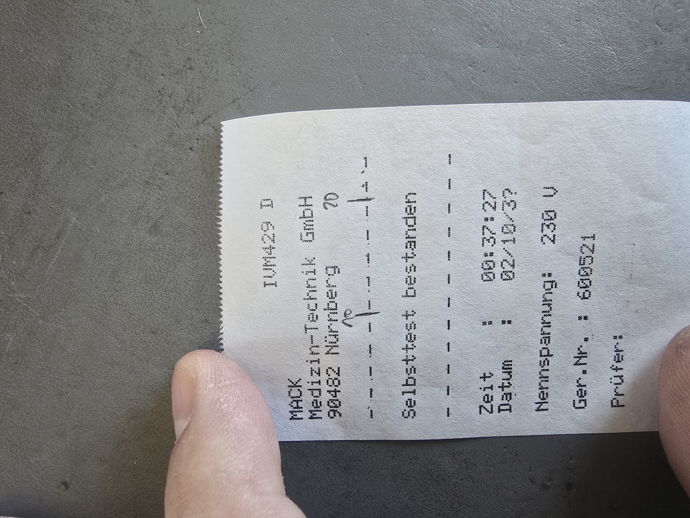

Field notes on a **Bender µP601 safety tester** (rating plate `µP 601-1`,
part number `B928161`, variant `IVM 429 D`, front panel *BENDER Medical
Division — µP SAFETY TESTER Model 601*): a single-phase electrical safety
tester for medical devices according to **IEC 601-1:1988** and
**DIN VDE 0751-1:1990**, built 1993 or later. Not part of the UNIMET range.

No manual, datasheet or service documentation for this device could be found
online. Everything here was worked out **from the outside, on a running
unit**.

## What you will find here

- **Identification and dating** — the DS601 three-phase adapter datasheet as
  the only public trace, rating plate, dating to July 1993 or later
- **Menu tree** — both operating modes (IEC 601-1:1988 and DIN VDE 0751T1/90),
  screen by screen, with the verbatim self-test printout
- **Built-in printer** — Datamega `DPN-240-24-S105` panel printer, 24 columns,
  ribbon `DPN-290-SW` (equivalent to Epson `ERC-21`), repair of the
  disintegrated ribbon drive roller
- **Power-on behaviour** — the tester checks which pin of its own mains plug
  carries the phase
- **Battery compartment** — leaked 2 × AA cells; the clock is lost, the
  ~69 stored test records survived
- **RS-232** — DB-25, `V.24/RS-232C`, 4800 baud: plan for capturing test
  reports digitally

## The short story

The unit was bought used and works. Since no documentation exists, the goal
is not a repair but to record everything the device does **before** it is
ever opened — every working state is an original that exists only once. The
next step is to find out whether the RS-232 port sends the printed reports
on its own.

**Do you have a manual, interface description or service documents for the
Bender µP601 / µP 601-1?** Please
[open an issue](https://github.com/feiglein74/bender-model-601/issues).

## Documents (German)

| Document | Content |
|---|---|
| [Status](research/STAND.md) | start here — identification, history, sources |
| [Functional survey](research/FUNKTIONSAUFNAHME.md) | front and rear panel, rating plate, power-on, printer |
| [Menu tree](research/MENUEBAUM.md) | screen by screen, self-test printout |
| [Battery](research/BATTERIE.md) | corrosion, clock without backup |
| [RS-232 capture](research/AUSLESEN.md) | draft: reading test reports via the serial port |
| [Sources](QUELLEN.md) | where to get the manufacturer documents |

Manufacturer documents are not published here (copyright).

Related: [Bender UNIMET 1000 ST — teardown & reverse engineering](https://feiglein74.github.io/bender-unimet-1000st/)
(a different, PC-based Bender tester).

Source: [github.com/feiglein74/bender-model-601](https://github.com/feiglein74/bender-model-601) ·
License: CC BY-SA 4.0 for own content, see [LICENSE](LICENSE.md).
